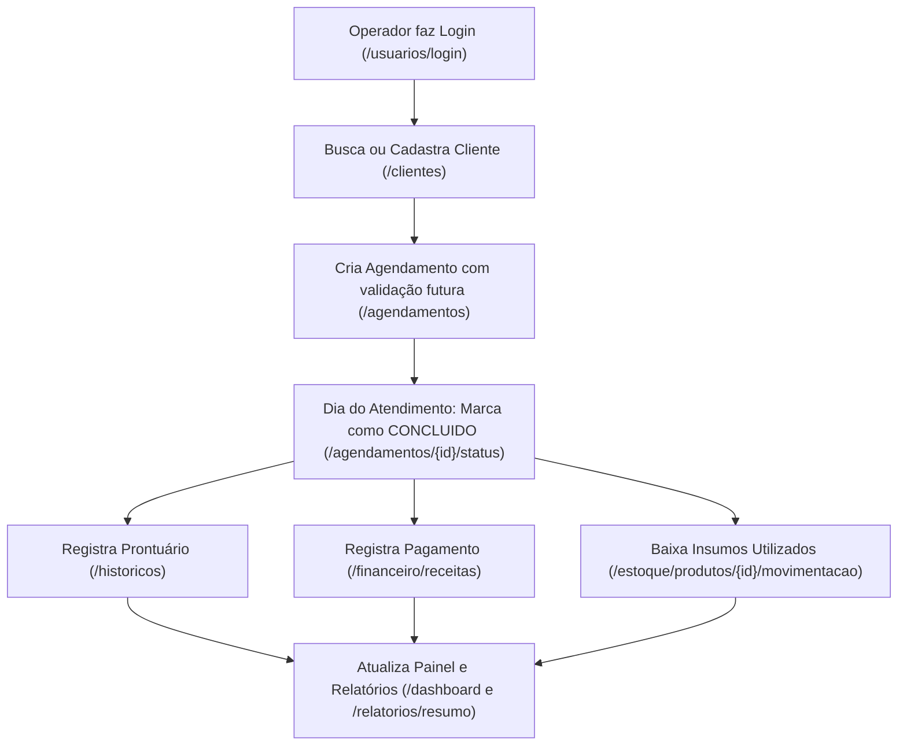
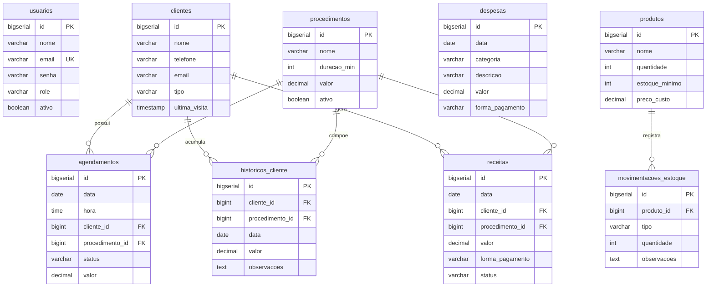

# 📘 Nexa Clínica — Catálogo e Documentação Completa dos Endpoints REST

> **Versão da API:** 1.0.0 (`v1`)  
> **Base URL:** `http://localhost:8080/api/v1`  
> **Formato de Dados:** `application/json; charset=UTF-8`  
> **Documentação Interativa (Swagger):** [http://localhost:8080/swagger-ui.html](http://localhost:8080/swagger-ui.html)  
> **OpenAPI Spec:** [http://localhost:8080/v3/api-docs](http://localhost:8080/v3/api-docs)

---

## 📑 Sumário

1. [Visão Geral e Arquitetura](#1-visão-geral-e-arquitetura)
2. [Padrões de Resposta e Códigos HTTP](#2-padrões-de-resposta-e-códigos-http)
3. [Catálogo Detalhado de Endpoints por Módulo](#3-catálogo-detalhado-de-endpoints-por-módulo)
   - [3.1. 👥 Clientes (`/api/v1/clientes`)](#31--clientes-apiv1clientes)
   - [3.2. 📅 Agendamentos (`/api/v1/agendamentos`)](#32--agendamentos-apiv1agendamentos)
   - [3.3. 📦 Estoque & Inventário (`/api/v1/estoque`)](#33--estoque--inventário-apiv1estoque)
   - [3.4. 💰 Financeiro (`/api/v1/financeiro`)](#34--financeiro-apiv1financeiro)
   - [3.5. 📋 Prontuário & Histórico Clínico (`/api/v1/historicos`)](#35--prontuário--histórico-clínico-apiv1historicos)
   - [3.6. 🧴 Procedimentos (`/api/v1/procedimentos`)](#36--procedimentos-apiv1procedimentos)
   - [3.7. 📊 Dashboard (`/api/v1/dashboard`)](#37--dashboard-apiv1dashboard)
   - [3.8. 📈 Relatórios Executivos (`/api/v1/relatorios`)](#38--relatórios-executivos-apiv1relatorios)
   - [3.9. 🔐 Usuários & Autenticação (`/api/v1/usuarios`)](#39--usuários--autenticação-apiv1usuarios)
4. [Ciclo de Vida Integrado de um Atendimento](#4-ciclo-de-vida-integrado-de-um-atendimento)
5. [Modelagem Relacional de Dados](#5-modelagem-relacional-de-dados)
6. [Coleção de Testes Práticos (cURL / PowerShell)](#6-coleção-de-testes-práticos-curl--powershell)

---

## 1. Visão Geral e Arquitetura

A API foi projetada em **Spring Boot 3.3.4** e **Java 21**, seguindo a arquitetura em camadas (*Layered Architecture*):
* **Controller Layer:** Mapeamento de endpoints REST, serialização de DTOs e validação com Bean Validation (`@Valid`).
* **Service Layer:** Regras de negócio, cálculo de métricas e orquestração transacional (`@Transactional`).
* **Repository Layer:** Acesso a dados via Spring Data JPA com resolução do problema N+1 via anotações `@EntityGraph`.
* **Database Migration:** Versionamento estrutural de esquema e cargas com Flyway (`db/migration/`).

---

## 2. Padrões de Resposta e Códigos HTTP

| Código HTTP | Significado | Quando é Utilizado |
|---|---|---|
| `200 OK` | Sucesso | Retorno de consultas (`GET`), atualizações (`PUT`/`PATCH`) e login (`POST`). |
| `201 CREATED` | Criado | Retorno de novos cadastros (`POST`) bem-sucedidos. |
| `204 NO CONTENT` | Sem Conteúdo | Retorno de exclusões (`DELETE`) bem-sucedidas. |
| `400 BAD REQUEST` | Requisição Inválida | Falha de validação de dados, agendamento no passado ou estoque insuficiente. |
| `404 NOT FOUND` | Não Encontrado | Registro inexistente para o ID informado. |
| `500 INTERNAL SERVER ERROR` | Erro Interno | Falha não tratada no servidor ou indisponibilidade de banco de dados. |

---

## 3. Catálogo Detalhado de Endpoints por Módulo

### 3.1. 👥 Clientes (`/api/v1/clientes`)

Controlador responsável pelo ciclo de vida cadastral dos clientes/pacientes da clínica.

#### `GET /api/v1/clientes`
* **Objetivo:** Lista todos os clientes cadastrados.
* **Status de Sucesso:** `200 OK`.
* **Exemplo de Resposta:**
```json
[
  {
    "id": 1,
    "nome": "Ana Clara Silva",
    "telefone": "(11) 98765-4321",
    "email": "ana.silva@email.com",
    "tipo": "ATIVO",
    "observacoes": "Pele seca e sensível",
    "ultimaVisita": "2026-10-15T14:30:00",
    "createdAt": "2026-09-01T10:00:00",
    "updatedAt": "2026-10-15T14:30:00"
  }
]
```

#### `GET /api/v1/clientes/{id}`
* **Objetivo:** Consulta detalhes de um cliente específico.
* **Parâmetros de Rota:** `id` (Long, obrigatório) — Identificador do cliente.
* **Status:** `200 OK` ou `404 NOT FOUND`.

#### `GET /api/v1/clientes/tipo/{tipo}`
* **Objetivo:** Filtra a base de clientes pelo status cadastral.
* **Parâmetros de Rota:** `tipo` (`ATIVO`, `POTENCIAL`, `INATIVO`).
* **Status:** `200 OK`.

#### `GET /api/v1/clientes/pesquisar?termo={termo}`
* **Objetivo:** Pesquisa dinâmica por aproximação no nome, telefone ou e-mail (ignora maiúsculas/minúsculas).
* **Parâmetros Query:** `termo` (String, obrigatório) — Texto de busca.
* **Status:** `200 OK`.

#### `POST /api/v1/clientes`
* **Objetivo:** Registra um novo cliente.
* **Validações:** `@NotBlank` no nome, validação de e-mail e formato.
* **Status:** `201 CREATED`.
* **Exemplo de Requisição (Body):**
```json
{
  "nome": "Juliana Martins",
  "telefone": "(11) 99123-4567",
  "email": "juliana.martins@email.com",
  "tipo": "ATIVO",
  "observacoes": "Interesse em protocolos de bioestimulador"
}
```

#### `PUT /api/v1/clientes/{id}`
* **Objetivo:** Atualiza dados cadastrais de um cliente existente.
* **Parâmetros de Rota:** `id` (Long).
* **Status:** `200 OK` ou `404 NOT FOUND`.

#### `DELETE /api/v1/clientes/{id}`
* **Objetivo:** Exclui o cliente e limpa com integridade referencial registros dependentes.
* **Regra de Negócio:** Remove primeiro históricos pregressos, agendamentos vinculados e receitas antes de deletar o cliente, evitando erro de Foreign Key.
* **Status:** `204 NO CONTENT`.

---

### 3.2. 📅 Agendamentos (`/api/v1/agendamentos`)

Controlador da agenda da clínica, com validações de data e consultas otimizadas.

#### `GET /api/v1/agendamentos`
* **Objetivo:** Lista todos os agendamentos cadastrados. Carrega os relacionamentos de cliente e procedimento via `@EntityGraph`.
* **Status:** `200 OK`.

#### `GET /api/v1/agendamentos/{id}`
* **Objetivo:** Busca agendamento por ID.
* **Status:** `200 OK` ou `404 NOT FOUND`.

#### `GET /api/v1/agendamentos/data/{data}`
* **Objetivo:** Lista todos os agendamentos agendados para um dia específico.
* **Parâmetros de Rota:** `data` (LocalDate no padrão `YYYY-MM-DD`).
* **Status:** `200 OK`.

#### `GET /api/v1/agendamentos/periodo?inicio={d1}&fim={d2}`
* **Objetivo:** Filtra agendamentos em um intervalo de datas.
* **Parâmetros Query:** `inicio` (LocalDate) e `fim` (LocalDate).
* **Status:** `200 OK`.

#### `GET /api/v1/agendamentos/cliente/{clienteId}`
* **Objetivo:** Histórico de agendamentos de um cliente específico.
* **Parâmetros de Rota:** `clienteId` (Long).
* **Status:** `200 OK`.

#### `POST /api/v1/agendamentos`
* **Objetivo:** Cria um novo agendamento na agenda.
* **Regra de Negócio (Validação Anti-Retroativa):**
  * Se `data < hoje`: Retorna `400 BAD REQUEST` ("Não é possível criar agendamento em datas que já passaram").
  * Se `data == hoje` e `hora < agora`: Retorna `400 BAD REQUEST` ("Não é possível criar agendamento em horário que já passou hoje").
* **Status:** `201 CREATED`.
* **Exemplo de Requisição (Body):**
```json
{
  "data": "2026-11-15",
  "hora": "15:00:00",
  "duracaoMin": 60,
  "valor": 320.00,
  "status": "CONFIRMADO",
  "observacoes": "Procedimento facial",
  "cliente": { "id": 1 },
  "procedimento": { "id": 2 }
}
```

#### `PUT /api/v1/agendamentos/{id}`
* **Objetivo:** Altera data, horário, procedimento, valor ou cliente de um agendamento.
* **Status:** `200 OK`.

#### `PATCH /api/v1/agendamentos/{id}/status?status={status}`
* **Objetivo:** Atualização rápida do estado de um agendamento.
* **Parâmetros Query:** `status` (`CONFIRMADO`, `AGUARDANDO`, `CANCELADO`, `CONCLUIDO`).
* **Status:** `200 OK`.

#### `DELETE /api/v1/agendamentos/{id}`
* **Objetivo:** Remove um agendamento cancelado ou criado por engano.
* **Status:** `204 NO CONTENT`.

---

### 3.3. 📦 Estoque & Inventário (`/api/v1/estoque`)

Controlador de insumos, auditoria de movimentações e controle de estoque mínimo.

#### `GET /api/v1/estoque/produtos`
* **Objetivo:** Lista todos os insumos e seus saldos em estoque.
* **Status:** `200 OK`.

#### `GET /api/v1/estoque/produtos/estoque-baixo`
* **Objetivo:** Filtra produtos onde `quantidade <= estoqueMinimo` para compra e reposição.
* **Status:** `200 OK`.

#### `GET /api/v1/estoque/produtos/{id}`
* **Objetivo:** Consulta informações de um produto por ID.
* **Status:** `200 OK` ou `404 NOT FOUND`.

#### `POST /api/v1/estoque/produtos`
* **Objetivo:** Cadastra um novo produto/insumo no inventário.
* **Status:** `201 CREATED`.
* **Exemplo de Requisição (Body):**
```json
{
  "nome": "Toxina Botulínica 100UI",
  "quantidade": 15,
  "estoqueMinimo": 5,
  "precoCusto": 480.00
}
```

#### `PUT /api/v1/estoque/produtos/{id}`
* **Objetivo:** Atualiza os dados cadastrais de um produto.
* **Status:** `200 OK`.

#### `DELETE /api/v1/estoque/produtos/{id}`
* **Objetivo:** Exclui o produto (removendo seu histórico de movimentações prévio).
* **Status:** `204 NO CONTENT`.

#### `GET /api/v1/estoque/movimentacoes`
* **Objetivo:** Relatório completo de auditoria de todas as entradas e saídas de estoque.
* **Status:** `200 OK`.

#### `GET /api/v1/estoque/produtos/{produtoId}/movimentacoes`
* **Objetivo:** Histórico de movimentações de um item específico.
* **Status:** `200 OK`.

#### `POST /api/v1/estoque/produtos/{produtoId}/movimentacao`
* **Objetivo:** Registra movimentação de entrada ou baixa com auditoria transacional.
* **Parâmetros Query:**
  * `tipo` (`ENTRADA` ou `SAIDA`)
  * `quantidade` (int positivo)
  * `obs` (String, opcional)
* **Regra de Negócio:** Caso `tipo == SAIDA` e `quantidade > saldoAtual`, a transação é abortada com `400 BAD REQUEST` ("Estoque insuficiente").
* **Status:** `201 CREATED`.

---

### 3.4. 💰 Financeiro (`/api/v1/financeiro`)

Gestão de contas a pagar, contas a receber e conciliação de pagamentos.

#### `GET /api/v1/financeiro/receitas`
* **Objetivo:** Lista todas as receitas registradas.
* **Status:** `200 OK`.

#### `GET /api/v1/financeiro/despesas`
* **Objetivo:** Lista todas as despesas operacionais da clínica.
* **Status:** `200 OK`.

#### `GET /api/v1/financeiro/receitas/periodo?inicio={d1}&fim={d2}`
* **Objetivo:** Filtra receitas dentro de um período.
* **Status:** `200 OK`.

#### `GET /api/v1/financeiro/despesas/periodo?inicio={d1}&fim={d2}`
* **Objetivo:** Filtra despesas dentro de um período.
* **Status:** `200 OK`.

#### `GET /api/v1/financeiro/pendentes`
* **Objetivo:** Lista todos os recebimentos com `status = PENDENTE`.
* **Status:** `200 OK`.

#### `POST /api/v1/financeiro/receitas`
* **Objetivo:** Lança uma nova receita.
* **Status:** `201 CREATED`.
* **Exemplo de Requisição (Body):**
```json
{
  "data": "2026-11-06",
  "valor": 450.00,
  "formaPagamento": "PIX",
  "status": "PAGO",
  "cliente": { "id": 1 },
  "procedimento": { "id": 3 }
}
```

#### `POST /api/v1/financeiro/despesas`
* **Objetivo:** Lança uma nova despesa operacional.
* **Status:** `201 CREATED`.
* **Exemplo de Requisição (Body):**
```json
{
  "data": "2026-11-06",
  "categoria": "EQUIPAMENTO",
  "descricao": "Manutenção preventiva de ponteiras de Laser",
  "valor": 650.00,
  "formaPagamento": "BOLETO"
}
```

#### `PATCH /api/v1/financeiro/receitas/{id}/pagar`
* **Objetivo:** Dá baixa em receita pendente, alterando seu status para `PAGO`.
* **Status:** `200 OK`.

#### `DELETE /api/v1/financeiro/receitas/{id}`
* **Objetivo:** Exclui um registro de receita.
* **Status:** `204 NO CONTENT`.

#### `DELETE /api/v1/financeiro/despesas/{id}`
* **Objetivo:** Exclui um registro de despesa.
* **Status:** `204 NO CONTENT`.

---

### 3.5. 📋 Prontuário & Histórico Clínico (`/api/v1/historicos`)

Registro da evolução médica/estética do paciente.

#### `GET /api/v1/historicos`
* **Objetivo:** Lista geral de todos os atendimentos pregressos em formato DTO.
* **Status:** `200 OK`.

#### `GET /api/v1/historicos/{id}`
* **Objetivo:** Consulta um atendimento do prontuário por ID.
* **Status:** `200 OK` ou `404 NOT FOUND`.

#### `GET /api/v1/historicos/cliente/{clienteId}`
* **Objetivo:** Linha do tempo de atendimentos pregressos de um cliente, ordenada de forma decrescente por data.
* **Status:** `200 OK`.

#### `POST /api/v1/historicos`
* **Objetivo:** Registra um novo atendimento no prontuário.
* **Regra de Negócio:** Atualiza automaticamente o atributo `ultimaVisita` no cadastro do cliente e assegura status `ATIVO`.
* **Status:** `201 CREATED`.
* **Exemplo de Requisição (Body):**
```json
{
  "data": "2026-11-06",
  "clienteId": 1,
  "procedimentoId": 3,
  "valor": 450.00,
  "observacoes": "Aplicação sem intercorrências. Reavaliar em 15 dias."
}
```

#### `PUT /api/v1/historicos/{id}`
* **Objetivo:** Atualiza dados ou anotações clínicas de um atendimento.
* **Status:** `200 OK`.

#### `DELETE /api/v1/historicos/{id}`
* **Objetivo:** Remove registro do histórico clínico.
* **Status:** `204 NO CONTENT`.

---

### 3.6. 🧴 Procedimentos (`/api/v1/procedimentos`)

Catálogo de serviços oferecidos pela clínica.

#### `GET /api/v1/procedimentos`
* **Objetivo:** Lista todos os procedimentos estéticos/médicos ativos com seus valores sugeridos e durações em minutos.
* **Status:** `200 OK`.

#### `POST /api/v1/procedimentos`
* **Objetivo:** Cadastra novo procedimento no catálogo.
* **Status:** `200 OK`.
* **Exemplo de Requisição (Body):**
```json
{
  "nome": "Microagulhamento Robótico",
  "duracaoMin": 50,
  "valor": 550.00,
  "ativo": true
}
```

---

### 3.7. 📊 Dashboard (`/api/v1/dashboard`)

Consolidação central de indicadores gerenciais para o painel principal.

#### `GET /api/v1/dashboard`
* **Objetivo:** Retorna em payload único todas as métricas em tempo real para a tela inicial.
* **Status:** `200 OK`.
* **Exemplo de Resposta:**
```json
{
  "totalClientes": 128,
  "clientesAtivos": 114,
  "novosClientesMes": 18,
  "agendamentosHoje": 7,
  "agendamentosConfirmadosHoje": 6,
  "faturamentoMes": 42500.00,
  "despesasMes": 13200.00,
  "lucroMes": 29300.00,
  "produtosCriticos": 3,
  "agendamentosHojeDetalhes": [
    {
      "id": 10,
      "hora": "09:00:00",
      "clienteNome": "Ana Clara Silva",
      "procedimentoNome": "Limpeza de Pele Profunda",
      "status": "CONFIRMADO",
      "valor": 250.00
    }
  ],
  "procedimentosPopulares": [
    {
      "nome": "Limpeza de Pele Profunda",
      "quantidade": 34,
      "percentual": 40,
      "cor": "#4f46e5"
    }
  ]
}
```

---

### 3.8. 📈 Relatórios Executivos (`/api/v1/relatorios`)

Compilação de métricas analíticas e estatísticas de desempenho histórico.

#### `GET /api/v1/relatorios/resumo`
* **Objetivo:** Retorna métricas globais consolidadas: volume total de atendimentos, faturamento histórico acumulado, estatísticas agrupadas por procedimento (volume, tempo médio de execução e total faturado) e curva de captação de clientes mensais.
* **Status:** `200 OK`.
* **Exemplo de Resposta:**
```json
{
  "totalAtendimentos": 482,
  "faturamentoTotal": 145900.00,
  "estatisticasProcedimentos": [
    {
      "nome": "Preenchimento Labial",
      "totalAtendimentos": 85,
      "tempoMedioMin": 45,
      "valorTotal": 85000.00
    }
  ],
  "novosClientesPorMes": [
    {
      "mes": "Outubro/2026",
      "novosClientes": 24
    }
  ]
}
```

---

### 3.9. 🔐 Usuários & Autenticação (`/api/v1/usuarios`)

Operadores da clínica, níveis de permissão (`RoleUsuario`) e login.

#### `POST /api/v1/usuarios/login`
* **Objetivo:** Valida credenciais de e-mail e senha.
* **Status:** `200 OK`.
* **Exemplo de Requisição (Body):**
```json
{
  "email": "clarissa@clinica.com.br",
  "senha": "admin123"
}
```
* **Exemplo de Resposta:**
```json
{
  "id": 1,
  "nome": "Dra. Clarissa Mendes",
  "email": "clarissa@clinica.com.br",
  "role": "ADMIN",
  "sucesso": true,
  "mensagem": "Autenticação realizada com sucesso"
}
```

#### `GET /api/v1/usuarios`
* **Objetivo:** Lista todos os usuários operadores cadastrados.
* **Status:** `200 OK`.

#### `GET /api/v1/usuarios/{id}`
* **Objetivo:** Consulta usuário específico por ID.
* **Status:** `200 OK` ou `404 NOT FOUND`.

#### `POST /api/v1/usuarios`
* **Objetivo:** Cadastra novo operador do sistema.
* **Status:** `201 CREATED`.
* **Exemplo de Requisição (Body):**
```json
{
  "nome": "Carla Ferreira",
  "email": "carla@clinica.com.br",
  "senha": "senhaSegura123",
  "role": "SECRETARIA",
  "ativo": true
}
```

#### `PUT /api/v1/usuarios/{id}`
* **Objetivo:** Atualiza dados de um operador (nome, e-mail, senha ou perfil).
* **Status:** `200 OK`.

#### `PATCH /api/v1/usuarios/{id}/ativar`
* **Objetivo:** Alterna o status do usuário entre ativo e inativo (bloqueio rápido sem deletar).
* **Status:** `200 OK`.

#### `DELETE /api/v1/usuarios/{id}`
* **Objetivo:** Exclui definitivamente um usuário operador.
* **Status:** `204 NO CONTENT`.

---

## 4. Ciclo de Vida Integrado de um Atendimento

Abaixo está o fluxo operacional de ponta a ponta demonstrando a interação entre os endpoints:



---

## 5. Modelagem Relacional de Dados



---

## 6. Coleção de Testes Práticos (cURL / PowerShell)

### Autenticação (Login)
```bash
curl -X POST http://localhost:8080/api/v1/usuarios/login \
  -H "Content-Type: application/json" \
  -d '{"email":"clarissa@clinica.com.br","senha":"admin123"}'
```

### Consultar Métricas do Dashboard
```bash
curl -X GET http://localhost:8080/api/v1/dashboard
```

### Buscar Clientes por Nome/Telefone
```bash
curl -X GET "http://localhost:8080/api/v1/clientes/pesquisar?termo=Mariana"
```

### Agendamentos de Hoje
```bash
curl -X GET "http://localhost:8080/api/v1/agendamentos/data/2026-11-06"
```

### Alerta de Insumos com Estoque Baixo
```bash
curl -X GET http://localhost:8080/api/v1/estoque/produtos/estoque-baixo
```

### Registrar Saída de Estoque
```bash
curl -X POST "http://localhost:8080/api/v1/estoque/produtos/1/movimentacao?tipo=SAIDA&quantidade=2&obs=Procedimento"
```

